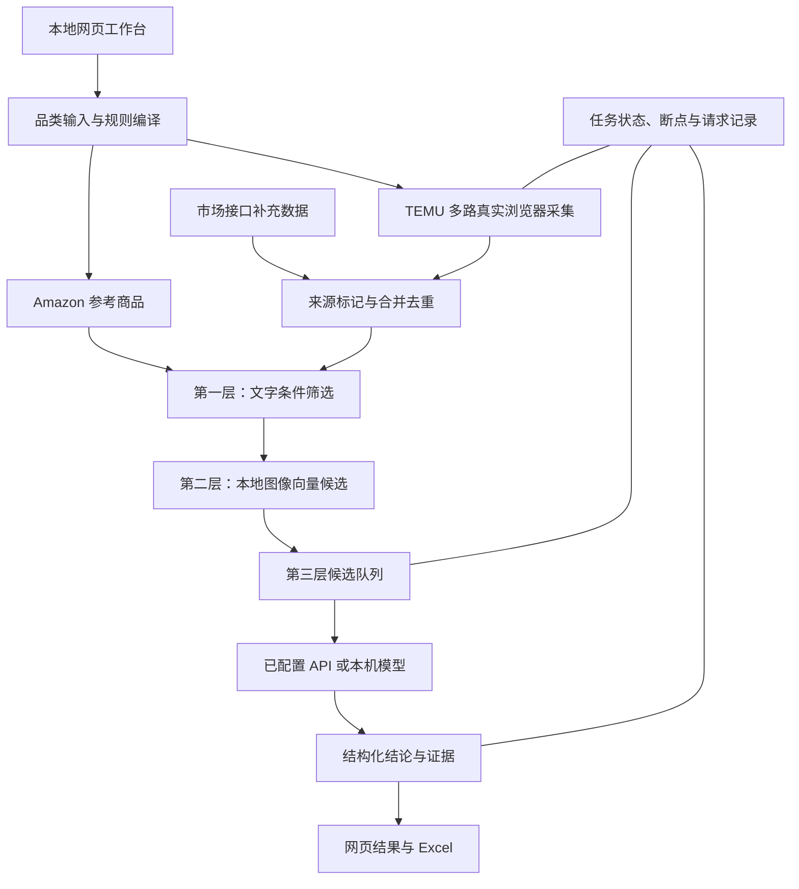

# 选品工作台｜Amazon × TEMU

**面向跨境选品的本地自动化与多模态分析工作台。**

从一个品类名称出发，连接 Amazon 参考商品、TEMU 真实前端采集、市场数据补充、三层商品匹配与 Excel 交付，让选品过程既能自动执行，也能追溯每个结论的输入、规则和证据。

`Windows 一键部署` · `真实浏览器采集` · `品类规则编译` · `多模态分层匹配` · `后台调度与断点恢复` · `可追溯 Excel`

## 先开始使用

### 1. 选择正确的交付内容

| 交付内容 | 面向使用者 | 包含内容 |
| --- | --- | --- |
| **完整内部包** `full-company.zip` | 获授权使用者，直接部署使用 | 程序、安装资产、公司配置及可携带的有效接口授权；仅在私密位置分发 |
| **公开发行源码／公开包** | 技术评估、研究与自行配置部署 | 经筛选的程序源码和部署入口；不含公司密钥、账号会话与业务任务数据 |

GitHub 自动生成的 **Source code** 压缩包不等于完整内部包。公开发行内容也不会自动获得公司服务权限。

### 2. 安装与打开

1. 将完整内部包全部解压到 **`D:\选品工作台`**，不要在 ZIP 内直接运行。
2. 双击 **`deploy.cmd`**，按必要的 Windows 授权提示操作，等待部署检查完成。
3. 部署完成后打开工作台；以后双击桌面上的 **“选品工作台”快捷方式**。

目标环境：**Windows 10/11 x64**，至少预留 **12 GB** 可用空间，并具备所用站点及服务的网络访问条件。完整内部包自行准备项目所需依赖，不要求使用者预装 Python、Node 或 Git。

完整内部包根目录附有 **`操作说明.html`**：前面是简略全流程，后面是带截图编号的详细图解。安装细节见 [部署与使用说明](docs/DEPLOYMENT_GUIDE.md)。

### 3. 跑完一次业务流程

| 步骤 | 在哪里操作 | 做什么 |
| --- | --- | --- |
| ① 定义任务 | 新建任务 | 填品类、Amazon 数量、TEMU 采集规模、并行路数与筛选门槛 |
| ② 准备规则 | 新建任务 | 生成关键词和规则，检查并应用修改，然后确认开始 |
| ③ 获取数据 | 运行总览 | 查看 Amazon、TEMU 与第一、二层处理进度；按提示处理站点验证 |
| ④ 深入判断 | 第三层控制区 | 选择已配置的方案，单独启动第三层，观察候选和队列进度 |
| ⑤ 交付结果 | 结果与导出 | 查看商品结论、判断证据及来源，打开或下载最新 Excel |
| ⑥ 暂停与继续 | 运行总览／历史记录 | 正常停止，恢复同一任务断点，保留已完成结果 |

例如门槛设为“同款＋相似款严格少于 5”，合计 **0～4** 才满足该项，等于 5 不满足。合格结果为 0 可以是正常业务结论；“无法判断”“未分析”和“不同款”分别保留，不混作一个答案。

## 核心能力

- **从品类生成执行规则。** 将出售主体、商品特征与变化影响组织为品类身份协议，再编译为文字筛选和图片判断条件，避免每增加一个品类就重写采集流程。
- **获取真实前端数据。** 通过独立浏览器环境读取 Amazon、TEMU 页面，保留商品来源、关键词、排序与观察信息；市场接口数据作为单独来源补充，再合并去重。
- **分层控制计算成本。** 第一层处理文字条件，第二层以本地图像向量筛出候选，第三层对候选执行模型判断。向量相似度用于候选召回，不冒充最终同款概率。
- **让长任务可以持续执行。** 网页负责操作，后台负责采集调度、分析队列和结果保存；支持正常停止、继续、历史任务恢复及增量处理。
- **把判断变成可交付结果。** 输出同款、相似、不同、无法判断及未分析状态，关联证据与阶段信息，生成可重新打开的 Excel 查看文件。

## 架构：从任务定义到证据交付

### 三层匹配各自解决什么问题

| 层级 | 方法 | 作用与结果边界 |
| --- | --- | --- |
| 第一层：文字筛选 | 品类协议、商品事实、匹配条件与冲突处理 | 排除明确不匹配项；缺失事实不伪造成已知事实 |
| 第二层：图片筛选 | PyTorch / Torchvision，ResNet50 ImageNet V2 特征与向量相似度 | 在本地形成视觉候选；相似度不并入第三层最终结论 |
| 第三层：同款判断 | 可配置模型服务、图片输入适配、规则约束和结构化结果解析 | 对候选给出同款／相似／不同／无法判断，并保留判断信息 |

第三层可以接入已配置的 API、本机模型及受支持的 Agent 方式。**接入能力、连接成功、真实推理成功与业务准确率是不同的验证层次。** 当前正式流程已验证 DeepSeek 方案；本机 D1 的效果需要独立评测，不能仅凭服务连通就宣称与 API 同等准确。

## 技术栈

| 模块 | 采用的技术 | 工程职责 |
| --- | --- | --- |
| 网页工作台 | HTML / CSS / JavaScript | 任务创建、规则编辑、进度展示、分析控制、结果与历史 |
| 本地服务与编排 | Python，标准库 HTTP 服务，进程与状态管理 | Windows 后台宿主、任务调度、断点和结果发布 |
| 浏览器采集 | Node.js / Playwright，AdsPower，WebDriver / BiDi 等连接适配 | 独立环境、多路采集、浏览器控制、session 恢复 |
| 图像计算 | PyTorch、Torchvision、ResNet50、Pillow、NumPy | 图像解码、特征计算、候选筛选与缓存 |
| 模型服务 | OpenAI SDK 与兼容接口适配、本机 D1 原生接口 | 模型发现、能力读取、请求转换、并发和结果解析 |
| 数据与表格 | JSON / JSONL、openpyxl、XlsxWriter | 增量记录、来源追溯、图片和中文 Excel 输出 |
| Windows 部署 | CMD、PowerShell、固定版本安装资产、Windows DPAPI | 一键安装、运行检查、凭据重新加密、快捷方式与诊断 |
| 验证与发行 | pytest、Node Test Runner、Git 提交构建、公开发行过滤 | 回归检查、版本对应、内部与公开内容分离 |

Python 项目依赖定义在 [`pyproject.toml`](pyproject.toml)，Node 依赖在 [`package.json`](package.json) 与锁文件中；完整包另带经构建固定的安装资产。

## 工程深度：难点在多个系统之间保持一致

### 1. 把模型规则落到确定的执行链

同一品类的文字条件、视觉条件与商品身份必须一致。项目将身份协议、规则编译、候选生成和结果标签分开处理，再让它们围绕同一任务流转，避免文字层说一种标准、图片层执行另一种标准。

### 2. 管理真实浏览器，而不只发送 HTTP 请求

采集涉及动态页面、浏览器环境配额、内核、登录态、代理出口与 session 生命周期。程序分别记录每路环境、任务进度和退出状态，使单路恢复能够沿用原任务断点，而不把整批任务清空重跑。

### 3. 在长任务中保存可解释状态

“进程存在”“网页刷新”“队列正在工作”并不是同一件事。工作台区分服务、采集、候选分析和产物更新；后台状态与网页、历史结果、Excel 围绕同一批次对应，支持部分结果持续保存。

### 4. 处理模型调用与资源约束

第三层包含服务能力读取、输入协议转换、并发控制、请求记录和结构化结果处理。已完成结果优先复用；未结算或费用未知的调用显式保留状态，不把不确定请求当成可免费无限重试。分析并发与浏览器并行分别配置。

### 5. 将安装当作产品能力交付

部署入口不仅解压文件，还要准备 Python、Node、浏览器组件、模型和项目环境，导入当前 Windows 使用者的配置，并实际检查图像推理、Excel、浏览器控制等运行条件。失败保留中文原因、原生退出信息与可导出的诊断记录。

### 6. 从源码到程序包保持版本关系

发行从已提交 Git 树构建，`BUILD_INFO.json` 记录提交与构建信息，发布包提供 SHA256。公开内容经过筛选，不携带公司配置、会话、运行数据或整段私密开发历史。

## 源码导览

| 位置 | 内容 |
| --- | --- |
| `web/` | 工作台界面与前端交互 |
| `scripts/web_console.py` | 本地网页服务与操作入口 |
| `scripts/*.mjs` | 浏览器采集与连接流程 |
| `src/selection_workflow/` | 增量文字、图片候选与匹配流程 |
| `src/selection_automation/` | 品类协议、服务适配、任务状态、凭据、市场与交付逻辑 |
| `install.ps1`、`deploy.cmd`、`start-web.cmd` | 安装及日常启动 |
| `tests/` | Python 与相关流程回归用例 |

## 使用边界与交付原则

- 站点登录、人机验证、403／429、账号权限和服务余额按实际提示处理，不伪装为程序已成功取得数据。
- 原始条数、去重件数、市场合并件数和商品比较对数分开统计；小样本完成不代表全量采集完成。
- 模型判断允许保留不确定状态；不以删除失败项、降低门槛或填入模拟数据制造“全通过”。
- 完整内部包仅供获授权使用者使用。公开仓库不包含密钥、账号缓存、浏览器会话及业务运行数据。
- 同机清理后重新部署，与恢复原始干净 Windows 后首装分别记录，不互相替代。
